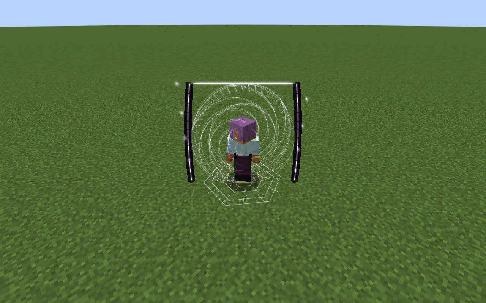

# Janus, Lord of Crossroads

[Main Page](../README.md) · [Skills](Skills.md) · [Ability index](Abilities.md) · [Damage types](Damage-Types.md)

**Janus, Lord of Crossroads** is an Ultimate Skill focused on **linked gates, opposing spatial blades and safe displacement**.

| Skill data | Janus, Lord of Crossroads |
| --- | --- |
| **Information** | |
| Type | Ultimate Skill |
| Combat role | Linked gates, opposing spatial blades and safe displacement |
| Active modes | 3 |
| Resource | Aura |
| Toggleable passive | Threshold Dominion |
| Passive upkeep | 110 aura / second |
| Registry ID | `wildhunt:janus` |
| **Obtaining** | |
| Method | Synthesis: master both ingredients; 2M total EP |
| **Evolution** | |
| Evolution | [Aion](Aion.md), [Thoth](Thoth.md) or [Lugh](Lugh.md) |

## Usage

### Passive

[Passive - Toggle] — **Threshold Dominion**

| Ability information | Value |
| --- | --- |
| Damage type | None — support / defense |
| Damage ID | — |
| Upkeep | 110 aura / second |

Gain 35% movement speed, 30% attack speed, 0.5 knockback resistance and 100% Space boost. Threshold Dominion rewards movement and spatial offense.

Elemental boosts use the [strongest ordinary source](Mechanics.md#elemental-bonus-sources); Godly bonuses apply separately.

Enable the native skill toggle in Ability Selection. The first second is paid on enabling; upkeep is paid every twenty game ticks. It turns off when unfunded or blocked by native activation rules. Turning it off removes only its own modifiers. It is separate from active mode cycling.

### Active

| Mode | Aura | Cooldown | Raw damage |
| --- | ---: | ---: | --- |
| 1. Twin Gates | 4,000 placement / 400 transit | 2 s | — |
| 2. Parallax Snare | 9,000 | 8 s | 1,900 |
| 3. Crossroads Edict | 16,000 | 18 s | 1,700 |

Damage listed here is before native combat handling and uses **1 + 0.5 × mastery fraction**, capped at **1.5×**. EP never multiplies their damage. Damaging arts carry native **level-1 resistance penetration**; native elemental boosts, resistance attributes, nullification fallback, authority, barriers and hit immunity remain relevant.

#### Twin Gates

[Active - Press] — **Twin Gates**

| Ability information | Value |
| --- | --- |
| Damage type | None |
| Damage ID | — |
| Resource cost | 4,000 aura placement / 400 aura transit |
| Cooldown | 2 seconds |
| Raw damage | — |

First cast costs **4,000 aura** and places a gate at your feet and a second safe point up to **48 blocks** along the aimed route. The pair lasts **thirty seconds**. Recast within four blocks of either gate to travel to the other, preserving horizontal and vertical momentum. Each successful transit costs **400 aura**; placement and transit share a **two-second cooldown**. A blocked destination or invalid placement is free and cannot teleport you into solid terrain.

#### Parallax Snare

[Active - Press] — **Parallax Snare**

| Ability information | Value |
| --- | --- |
| Damage type | Space elemental |
| Damage ID | `tensura:space_elemental` |
| Resource cost | 9,000 aura |
| Cooldown | 8 seconds |
| Raw damage | 1,900 |

Mark a point within **48 blocks**. Opposing spatial blades close around a **seven-block radius** and strike after **0.8 seconds**, for 1,900 raw Space damage. The warning stays fixed; up to eight visible enemies can be hit.

When cast within four blocks of a live gate, a second snare opens at the **opposite endpoint** if that endpoint is more than fourteen blocks from the first warning. This keeps the two targeting regions separate. Each snare has its own eight-enemy cap.

#### Crossroads Edict

[Active - Press] — **Crossroads Edict**

| Ability information | Value |
| --- | --- |
| Damage type | Space elemental |
| Damage ID | `tensura:space_elemental` |
| Resource cost | 16,000 aura |
| Cooldown | 18 seconds |
| Raw damage | 1,700 |

Choose a field center within 32 blocks. Up to six visible enemies within ten blocks are displaced to their mirrored horizontal positions across the center. Each destination is checked against collision, build height and world border. An unsafe displacement leaves that enemy in place. Each resulting position is then marked with a fixed **2.5-block-radius cut** that strikes after **0.6 seconds**, for **1,700 raw Space damage**. Enemies can leave the warning. Placement attempts native Movement Interference for **1.75 seconds**; its normal status protections apply.

## Obtaining

Open **Skills → Ultimate → Synthesis**. Choose Janus and combine **[Threadweaver](Threadweaver.md) + [Mirrorbound](Mirrorbound.md)**, with both mastered and at least **2,000,000 total EP**. Any race can synthesize. Both ingredients are replaced only after native storage accepts the result. Other skills remain learned. All nine presets and the longest remaining ingredient cooldown carry over; the new Ultimate starts with its own mastery.

## Suggested combo

Place Twin Gates across a safe lane → cross to change your attack angle → mark Parallax Snare and use Crossroads Edict to disturb enemy positioning.

## Strengths and limitations

Only your owner can use the gates. Gates do not transport across dimensions. Hostile teleportation never bypasses destination safety; native defenses can still block status or damage.

Attacks respect teams, owned pets, creative/spectator immunity and server PvP settings. Native status resistances apply. World effects are bounded, expire automatically and do not damage terrain. Anchored effects do not persist across death, relog or dimension changes.

## Related pages

[Skills](Skills.md) · [Skill synthesis](Skill-Synthesis.md) · [Damage types](Damage-Types.md) · [Mechanics](Mechanics.md)

## Visual effects

Twin Gate builds two freestanding frames with recessed, counter-rotating spiral apertures; entry and exit have distinct violet and gold accents. Passage leaves a short spatial transit streak. Parallax Snare closes opposing luminous cuts toward its warned center, while Crossroads Edict lays out a wide cartographic grid and cardinal anchors.

[Visual effects gallery and display settings](Visual-Effects.md).

---

**Categories:** Tensura Myths · Skills
