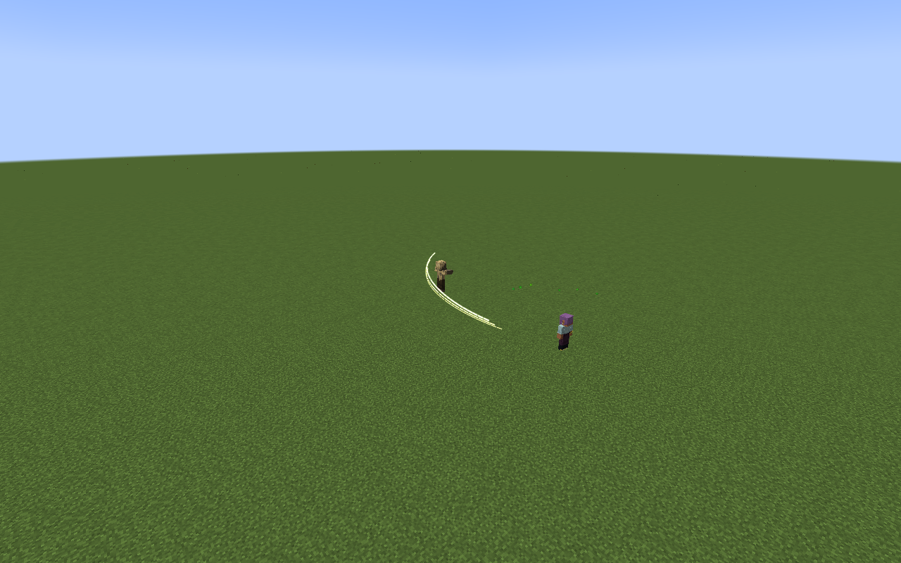

# Lugh, God of Skills

[All wikis](../README.md) · [Tensura Myths](Tensura-Myths.md)

Lugh, God of Skills is a Godly Skill for analysing, reconstructing and combining combat techniques. Its persistent Skill Bank and three bound techniques determine the forms and damage types of its attacks, while Countermand seals one enemy technique temporarily.

| Skill data | Value |
| --- | --- |
| Tier | Godly |
| Resource | Magicules |
| Passive upkeep | 240 magicules / second |
| Maximum mastery | 50,000 |
| Obtaining | Mastered combination Ultimate + mastered Threadweaver; true awakening; 12M total EP |

## Active abilities

| Ability | Damage type / base damage | Cost | Cooldown |
| --- | --- | --- | --- |
| Skill Bank | None | Free | None |
| Reconstructed Art | Variable normalised physical, elemental or generic magic · 3,500–6,000 raw | 10,000; selection/binding are free | 4 s |
| Countermand | None | 9,000 magicules | 18 s |
| Grand Synthesis | Three bound normalised damage types · Three bound attacks at 1.6× their reconstruction damage | 30,000 magicules | 40 s |

## Classification passives

Owning this skill grants the always-active [Godly classification passives](Godly.md#classification-passives), independently of its toggle.

## Passive

- Damage type: None — learning, cooldown support and technique analysis
- Upkeep: 240 magicules / second
- Gain +49 native learning points and +49 native mastery points per gain, 35% movement speed, and 50% shorter cooldown recovery for other skills. The point bonuses are flat additions to Tensura’s native gain attributes, rather than percentage multipliers.

**Lugh’s own cooldowns are excluded.** While toggled, automatically record damaging techniques demonstrated within **64 blocks**. The original user keeps their skill.

## Skill Bank

- Damage type: None — technique storage and selection
- Magicule cost: Free
- Cooldown: None
- Collection range: 64 blocks around the user of a damaging technique, while All-Skilled is enabled
- Press the assigned key to open the searchable bank directly. Crouching is not required; crouching also opens the same menu.

## Reconstructed Art

**Damage type:** the bound entry’s ordinary Physical, elemental or generic magic type. Bind techniques in Skill Bank. Reconstruction uses **80% of the observed damage**, bounded to **3,500–6,000**, and hits at most **8 enemies**.

| Form | Targeting |
| --- | --- |
| Blade | Forward fan within 16 blocks |
| Lance | Cursor ray up to 64 blocks; solids stop it, fluids do not |
| Crown | Aim within 48 blocks; 9-block explosion radius |

Reconstruction does not copy the original skill’s full utility or instant-kill behavior.

## Countermand

- Damage type: None — temporary activation seal
- Range: 48 blocks
- Duration: 6 seconds
- Aim at an enemy with a recent damaging technique. Seal that one originating non-Godly ability, stopping new activations through native skill events and Tensura's activation checks.

## Grand Synthesis

- Damage type: The three bound entries, in slot order
- Placement range: 64 blocks
- Formation radius: 10 blocks
- Timing: 1.0, 1.8 and 2.6 seconds after casting
- Snapshot all three bound entries into a fixed, warned formation. Three floating rune tablets assemble into the corresponding armaments, each striking for 1.6× its recorded raw damage before mastery and native handling.

## Related

[Skill synthesis](Skill-Synthesis.md) · [Godly Skills](Godly.md)

## Pictures and video

