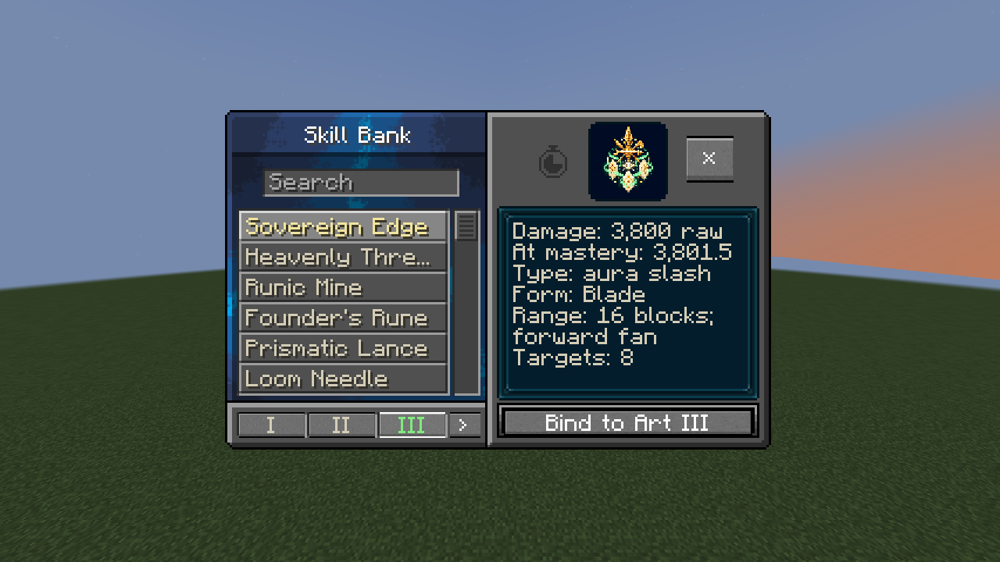
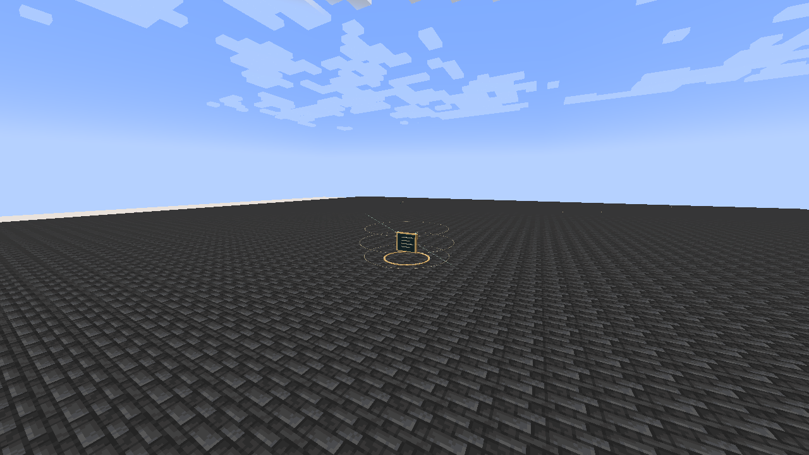

# Lugh, God of Skills

[Main Page](../README.md) · [Godly Skills](Godly.md) · [Ability index](Abilities.md) · [Damage types](Damage-Types.md)

**Lugh, God of Skills** is a Godly Skill for **analysing, reconstructing and combining combat techniques**. Its persistent Skill Bank and three bound techniques determine the forms and damage types of its attacks, while Countermand seals one enemy technique temporarily.

| Skill data | Lugh, God of Skills |
| --- | --- |
| **Information** | |
| Type | Godly Skill / native Ultimate |
| Combat role | Technique reconstruction, targeted skill sealing and adaptable finishers |
| Active modes | 4 |
| Resource | Magicules |
| Toggleable passive | All-Skilled |
| Passive upkeep | 240 magicules / second |
| Maximum mastery | 50,000 |
| Registry ID | `wildhunt:lugh` |
| **Obtaining** | |
| Method | Mastered combination Ultimate + mastered Threadweaver; true awakening; 12M base EP |
| **Evolution** | |
| Evolution | — |

## Usage

### Classification passives

Lugh ownership automatically grants [Divine Authority, Absolute Penetration and Interference Immunity](Godly.md#classification-passives). These provide +35% damage against non-Godly owners, resistance/nullification bypass for your own damage, and protection from non-Godly-origin Magic Interference. They require no toggle or upkeep and do not stack with another Godly skill's shared traits.

### Passive

[Passive - Toggle] — **All-Skilled**

| Ability information | Value |
| --- | --- |
| Damage type | None — learning, cooldown support and technique analysis |
| Damage ID | — |
| Upkeep | 240 magicules / second |

Gain **+49 native learning points** and **+49 native mastery points per gain**, **35% movement speed**, and **50% shorter cooldown recovery for other skills**. The point bonuses are flat additions to Tensura’s native gain attributes, rather than percentage multipliers. Native learning costs, learning rules and mastery caps still apply.

Other skills’ cooldowns recover **twice as fast** through ManasCore’s normal cooldown update pipeline while the toggle is active. **All of Lugh’s own cooldowns are excluded.** Already-running cooldowns benefit only while All-Skilled remains active; toggling repeatedly never resets or re-halves a stored timer. Native cooldowns use whole-second counters, so odd values finish on the next native update.

All-Skilled also **automatically records damaging techniques demonstrated by users within 64 blocks**. No crosshair target, manual scan or extra scan payment is required. The observation uses the technique user’s position and the actual native damage source. It can record your other techniques and allies’ techniques; Lugh’s own arts are excluded to prevent recursive copies. Missed attacks and purely non-damaging utility moves do not provide a damage reading.

The first upkeep second is paid when enabled. Collection, faster cooldown recovery and gain modifiers end when the toggle is disabled, unfunded or blocked by native activation rules. It generates no passive barrier or attack-speed bonus.

The bank, existing bindings and active arts remain usable with All-Skilled off; automatic collection requires the toggle.

### Technique archive

The **Skill Bank** stores up to **256 techniques**, including three usable origin techniques. The **three Art slots** are a separate loadout:

| Entry | Form | Damage type | Raw reconstruction damage |
| --- | --- | --- | ---: |
| Sovereign Edge | Blade | Physical aura slash — `tensura:aura_slash` | 3,800 |
| Heavenly Thread | Lance | Space elemental — `tensura:space_elemental` | 3,800 |
| Founder's Rune | Crown | Earth elemental — `tensura:earth_elemental` | 4,200 |

**Press Skill Bank normally** to open a menu styled after native **Pride’s copied-skill list**, with search, six visible list entries, a scrollbar, source-skill icons and a scrolling parameter panel. Opening the menu is free, ignores any legacy cooldown on the menu mode, and needs neither magicules nor a target.

To bind a technique:

1. Select it in the left-hand list. Search by skill, technique, damage type or form.
2. Choose **Art I**, **Art II** or **Art III** at the bottom left.
3. Press **Bind to Art I / II / III** at the bottom right.

The highlighted Art slot is the active Reconstructed Art. Hover over a slot to see its bound technique. **Crouch + Reconstructed Art** cycles the three bindings without payment, cooldown changes or mastery gain. Binding and selection are also free; they do not cast an attack.

The parameter panel shows **raw reconstruction damage**, damage at your current mastery, native damage type/ID, form, range, width or radius, target cap, reconstruction cost/cooldown, and Synthesis multiplier. Observed records additionally show the **observed damage-calculation amount**, original source type, originating skill and technique. Scroll the panel to read all parameters. Final combat damage also uses native modifiers and Godly traits.

All-Skilled **adds** observed techniques automatically. A repeat use of the same source skill and mode refreshes that record and every slot bound to it. Different modes of one skill can have separate entries. Newly observed techniques leave your bindings unchanged until you explicitly bind them. At the 256-entry limit, known techniques can still refresh; new entries are ignored without erasing anything or adding a scan cost.

The library, bindings and active slot survive normal save/load and lifecycle cleanup while Lugh is retained.

### Active

| Mode | Magicule cost | Cooldown | Damage |
| --- | ---: | ---: | --- |
| 1. Skill Bank | Free | None | — |
| 2. Reconstructed Art | 10,000; selection/binding are free | 4 s | 3,500–6,000 raw |
| 3. Countermand | 9,000 | 18 s | — |
| 4. Grand Synthesis | 30,000 | 40 s | Three bound attacks at 1.6× their reconstruction damage |

Mastery scales damaging arts by **1 + 0.5 × mastery fraction**, capped at 1.5×. Native elemental boosts, barriers, hit immunity, authority and PvP rules remain relevant. The shared Godly traits apply separately. Damage never scales with EP.

#### Skill Bank

[Active - Press] — **Skill Bank**

| Ability information | Value |
| --- | --- |
| Damage type | None — technique storage and selection |
| Damage ID | — |
| Magicule cost | Free |
| Cooldown | None |
| Collection range | 64 blocks around the user of a damaging technique, while All-Skilled is enabled |

Press the assigned key to open the searchable bank directly. Crouching is not required; crouching also opens the same menu. Neither opening nor editing bindings needs a target, magicules or a fresh observation, and neither awards mastery.

The passive records the originating skill and mode, original and normalised damage types, observed intensity and attack form. The original user keeps their skill. Reconstruction’s raw damage is **80% of the observed damage-calculation amount**, bounded to **3,500–6,000**. This amount may already include native modifiers at observation time; it is not the entire damage budget of a multi-hit skill.

Projectile or distant single-target techniques become **Lance** forms. Other physical techniques become **Blade** forms. Nearby non-physical techniques and same-tick attacks observed on distinct victims become **Crown** forms. Subsequent demonstrated hits update the reading automatically while within range.

Elemental sources retain their recognised element. Special sources such as disintegration or instant-kill damage are reconstructed as ordinary generic magic, or aura slash for physical techniques. Lugh reconstructs bounded combat forms; it does not execute another mod’s skill code, copy utility effects, inherit instant-kill rules or grant the original as a separately owned skill. Floating rune tablets and scanning threads mark passive observations, with a short visual throttle for multi-hit attacks.

#### Reconstructed Art

[Active - Press] — **Reconstructed Art**

| Ability information | Value |
| --- | --- |
| Damage type | Active bound entry: physical, elemental or generic magic |
| Damage ID | `tensura:aura_slash`; `tensura:magic`; or a supported native elemental ID |
| Target cap | 8 enemies |

Use the technique bound to the active Art slot in one of three distinct geometries:

- **Blade:** sweep a forward fan within **16 blocks**. Ivory/gold cutting arcs trace the sweep.
- **Lance:** fire along the cursor direction up to **64 blocks**, with a 1.4-block targeting width. Solid blocks stop it; fluids do not. A reconstructed spearhead travels along the visible path.
- **Crown:** erupt at the aimed location within **48 blocks**, damaging enemies in a **nine-block radius**. A crown of downward armaments identifies its area.

The attack is attributed to **you and Lugh**, using native Ultimate compatibility and the selected ordinary damage type. Supported elements are Earth, Fire, Water, Ice, Wind, Lightning, Light, Darkness, Space and Gravity. The form's gold/ivory armament style identifies reconstruction; it does not impersonate the original skill's full animation.

#### Countermand

[Active - Press] — **Countermand**

| Ability information | Value |
| --- | --- |
| Damage type | None — temporary activation seal |
| Damage ID | — |
| Range | 48 blocks |
| Duration | 6 seconds |

Aim at an enemy with a recent damaging technique. Seal **that one originating non-Godly ability**, stopping new activations through native skill events and Tensura's activation checks. Its other skills remain available. Godly-origin techniques cannot be sealed, even if their native compatibility type is Ultimate. A Godly owner can still have an ordinary technique sealed by this Godly art.

The victim retains their learned skill, mastery, toggle state and saved cooldowns. Countermand does not delete ownership, cancel already-fired projectiles, turn off unrelated passives or create a global silence field. The seal expires automatically; forgetting Lugh or the caster's lifecycle cleanup releases its tracked targets. A crossed, locked rune tablet marks the victim, who receives a notice naming the sealed technique.

Missing or Godly observations fail without payment or cooldown. Third-party skills that bypass both native activation events and Tensura's activation checks may have their own behavior.

#### Grand Synthesis

[Active - Press] — **Grand Synthesis**

| Ability information | Value |
| --- | --- |
| Damage type | The three bound entries, in slot order |
| Damage ID | Each entry's normalised native damage ID |
| Placement range | 64 blocks |
| Formation radius | 10 blocks |
| Timing | 1.0, 1.8 and 2.6 seconds after casting |

Snapshot all three bound entries into a fixed, warned formation. Three floating rune tablets assemble into the corresponding armaments, each striking for **1.6× its recorded raw damage** before mastery and native handling.

Blade and Crown phases strike the fixed area; a Lance phase cuts a cross through its center with narrow horizontal arms. Each phase targets up to eight eligible enemies. Reappraising techniques or changing bindings after casting does not change the pending plan. Sixteen ticks separate phases, preserving native hit-immunity rules. Enemies can leave the formation.

Death, forgetting, relogging or dimension changes cancel pending strikes. The attack does not consume the learned library and does not edit terrain.

## Obtaining

Master any of the [five combination Ultimates](Ultimate-Skills.md) and [Threadweaver](Threadweaver.md), become a **True Hero or True Demon Lord**, and reach **12M base EP**. Open **Skills → Godly → Ascension**, select the source Ultimate, cycle the destination to **Lugh**, then Ascend.

Both the selected Ultimate and Threadweaver are combined. Presets and the longest remaining cooldown carry over. EP is a requirement, not a payment. The server's `godlyEP` setting controls the default gate. Owning Aion or Thoth does not prevent a separate valid Lugh ascension.

## Suggested combo

Enable All-Skilled to collect nearby demonstrated techniques → press Skill Bank and bind the form that suits the approach → Countermand the technique they rely on → place Grand Synthesis across their escape route → use Reconstructed Art while they leave the formation.

## Gallery

[Visual effects gallery](Visual-Effects.md).

---

**Categories:** Tensura Myths · Skills · Godly
