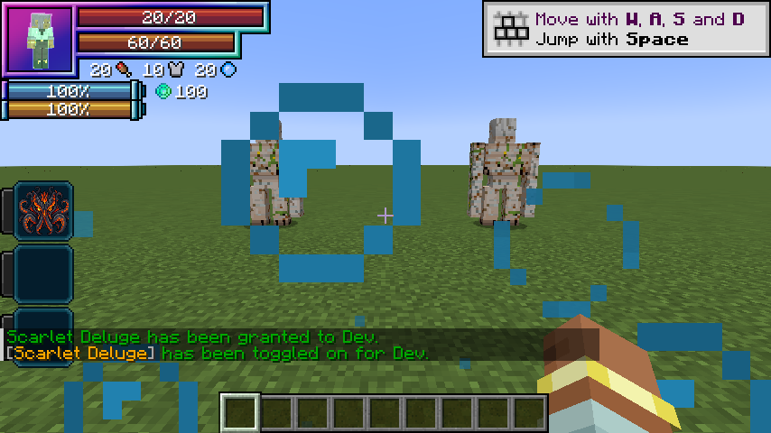
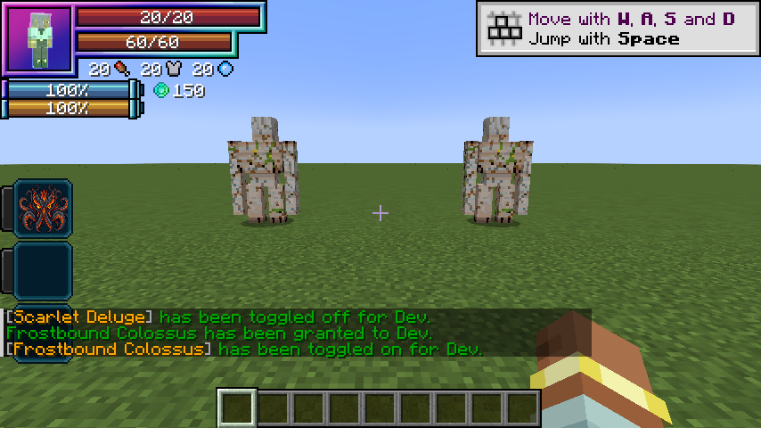
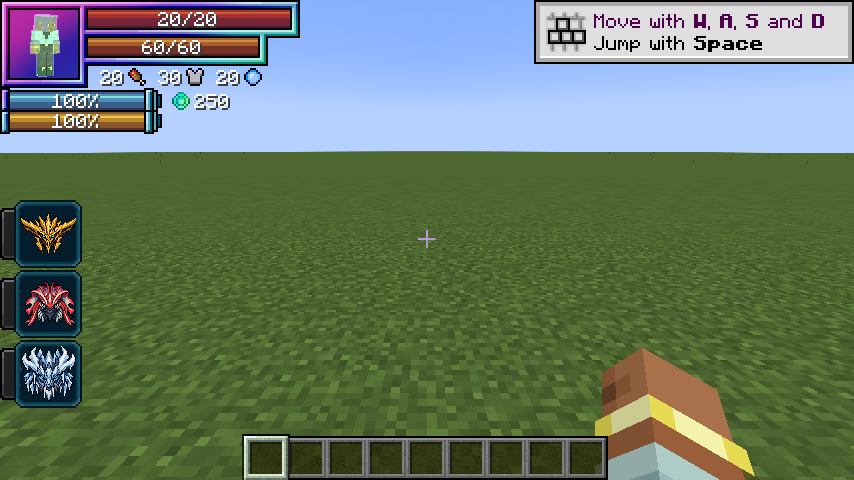

# Combat mechanics

[Main Page](../README.md) · [Skills](Skills.md) · [Evolution](Evolution.md) · [Mechanics](Mechanics.md) · [Commands](Commands.md)

This page explains **Wild Hunt combat mechanics**, including native barriers, skill toggles, damage modifiers, and aura consumption.

## Damage and mastery

Wild Hunt’s damage multiplier is:

```text
0.90 × (1 + 0.5 × clamp(masteryFraction, 0, 1)) × (Ultimate ? 3 : 1)
```

**No EP term is present.** After the 10% damage reduction, mastery caps at 1.35× the old Unique raw base, or 4.05× that base for a mastered Ultimate. The reduction also covers every area pulse, counter and signature impact. Skill-page tables already include the Ultimate’s 3× multiplier. Native Tensura elemental boosts, global combat rules, rank interactions, barriers and resistances still apply; raw values do not promise the same health damage against every enemy.

EP remains a requirement for race evolution and Ultimate ascension. Those progression gates do not increase these attacks’ raw damage.

## No passive stacks

Storm charge, owned oil stacks and owned rime stacks are removed. No attack builds, consumes or amplifies damage from them. Old marks are ignored and removed as entities tick. There is no shatter threshold or melee coating.

Oil pools remain finite **world locations**, not passive stacks on a character. Drenched remains one timed water mark: it has no counter or buildup and supports the documented water/lightning interactions.

## Toggleable passives

Each skill has two active modes (three for an Ultimate) plus a separate native skill toggle in Tensura’s Ability Selection. The old final buff modes are removed from mode cycling.

| Line | Passive | Unique aura / second | Ultimate aura / second |
| --- | --- | ---: | ---: |
| Rey Dau | Storm Mantle | 10 | 40 |
| Uth Duna | Water Veil | 10 | 40 |
| Nu Udra | Furnace Mantle | 15 | 60 |
| Jin Dahaad | Colossus Carapace | 20 | 80 |

The first second is paid when enabling; upkeep is charged once every twenty game ticks while active. Passives stay on until disabled, unfunded or blocked by activation requirements. They do not expire after fifteen or thirty seconds. Attribute contributions use stable IDs, so refreshes cannot accumulate duplicate bonuses. Turning off or forgetting the skill removes its modifiers. Saved native toggle state is restored on login.

## Native barriers

Water Veil and Colossus Carapace contribute to Tensura’s `PHYSICAL_BARRIER` and `MAGIC_BARRIER` attributes and now arm `MULTILAYER_BARRIER`, which is the attribute read by its shield HUD counter. Tensura handles their interaction with damage and renders its native barrier layer around the character. Wild Hunt adds no absorption hearts and does not implement a parallel shield-health pool. Other skills’ barrier contributions remain separate.

| Passive | Unique capacity | Ultimate capacity |
| --- | ---: | ---: |
| Water Veil | 100 | 250 |
| Colossus Carapace | 150 | 350 |

The displayed value is native per-hit blocking capacity. Tensura charges magicules for blocked damage. Overflow, inadequate magicules and native power interactions can break the shield. A broken multilayer barrier automatically rearms at the first paid upkeep after ten seconds without a hit (normally 10–11 seconds). Hits, including fully blocked hits, restart recovery. Retoggling cannot skip this delay. The shield modifier is saved across relogs; turning off removes only this art’s contribution. Ensure Tensura’s **Barrier** HUD decoration is enabled if you have customized its HUD.

Water Veil retains water breathing and an attacker-targeted retaliation after actual health damage. Furnace Mantle retains fire protection while enabled; both utility effects stop immediately on toggle-off without leftover timed potions. Furnace Mantle no longer oils melee victims. The old frost ward’s projectile deletion and interception budget are removed.

## Aiming and movement

Railbolt begins with a block-clipped aimed hit, then ricochets from the latest victim. Thunder Step follows the full aim vector, including vertical pitch, and sweeps the whole caster bounding box. Collisions, build-height limits and the world border stop it. Railbolt bounces reach twelve blocks through walls from the most recent victim. Thunder Step reaches 16/24 blocks with a 5/4 second cooldown and preserves all three components of player momentum. Undertow is placed on the crosshair ray within 24/36 blocks, using the hit surface or bounded endpoint. Water waves sweep continuous segments so targets cannot hide between movement updates. Oil Lash selects a limited forward fan and creates synced tentacle geometry. Avalanche Crash is an aimed area impact; Glacial Prison targets one enemy. Heavenfall Glacier warns fixed positions for half a second before impact.

Attacks respect teams, owned pets, creative/spectator immunity and PvP settings. They check line of sight except for Railbolt ricochets after the initial hit. Movement respects knockback resistance. Dimension changes invalidate anchored effects. Native status resistance and skill ranks can prevent Frost or Chill. No art destroys terrain or places permanent ice.

## Aura regeneration

See [Aura regeneration](Aura-Regeneration.md) for the three race-granted Extra Skills, healing speed, aura costs, suppression and death-prevention limits. They never charge magicules. Default native EP gain stays split two thirds aura and one third magicules.

## Visual effects

Water waves render a broad curled mesh with a foam crest; Undertow renders rotating teal and coral spiral ribbons. Water and ice toggles emit no constant custom particles. Oil Lash uses a synced procedural mesh with a dark tapered body, glowing orange bands, extension and recoil, including on a miss. Ice spires, prison bars and falling ice use rendered faceted crystals. Those visual entities deal no damage by themselves, have no collision and expire automatically; server skill logic owns targeting and damage.

Tensura supplies elemental particles, shockwaves, native barrier rendering and animated magic circles. Its assets are used at runtime and are not copied into the addon.

## Barrier HUD examples





Captured with the Unique passives enabled in the Minecraft development client, Wild Hunt 0.6.0.



Wild Hunt 0.7.0: centered Rey Dau, Uth Duna and Jin Dahaad portraits. The native HUD shows 250 combined capacity with both Unique barrier passives enabled (100 Water Veil + 150 Colossus Carapace); no custom bubble/frost orbit is emitted.

## Hunter vitality

Race HP bonuses are +100 / +500 / +1,000; native SHP bonuses are +400 / +3,200 / +6,600. These replace earlier hunter-stage bonuses. Existing saved hunters get the updated caps on login without being healed. See [Human evolution](Evolution.md#hp-and-shp-growth).

## Updating saved characters

Version 0.7.0 refreshes race vitality on login, grants missing racial regeneration skills, and leaves current HP/SHP unchanged. Barrier cooldowns and surviving shield state remain saved.


Version 0.5.0 introduced the mode migration and keeps learned skills, mastery and distinct boss history. It removes old transient combat timers and resources, drops the old buff mode, and moves the former fourth Ultimate mode into the third active slot while preserving/capping its cooldown. Equipped presets migrate with the mode list. When upgrading from pre-0.5.0 combat, legacy toggle passives start off; no skill reroll is needed. A matching still-active legacy Water Veil absorption effect is cleared during migration. Version 0.6.0 added native HUD barriers to already-enabled passives on login and refreshes hunter HP/SHP modifiers; existing toggle state, mastery and boss history remain intact.

---

**Categories:** Tensura: Wild Hunt · Version 0.7.0
