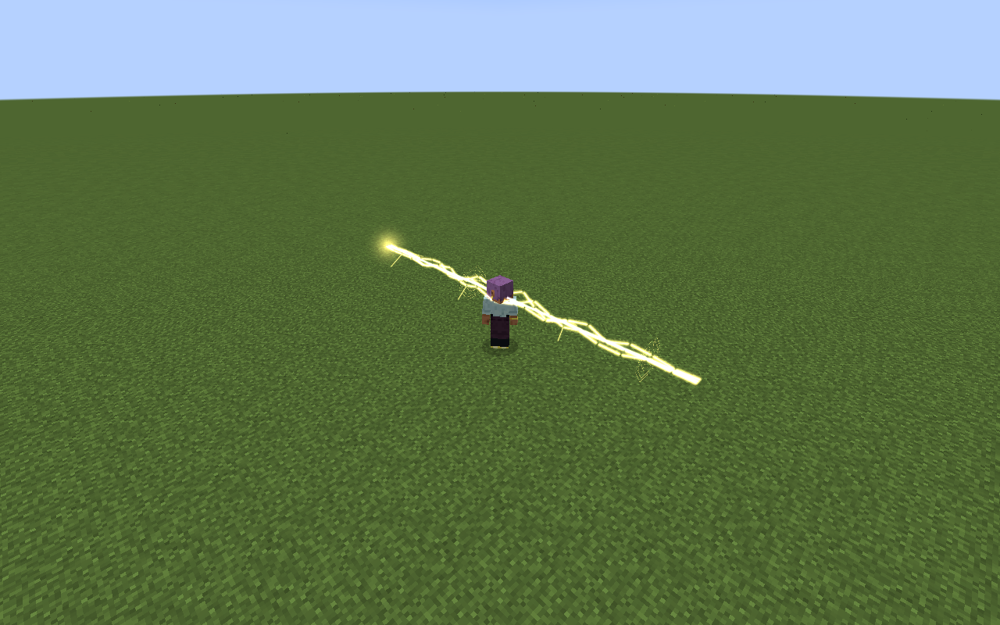

# Storm Crown

> **Discontinued archive:** Tensura Myths ended at 0.36.1. No further updates are planned.

[All wikis](../README.md) · [Tensura Myths](Tensura-Myths.md)

Storm Crown is a Unique Skill inspired by Rey Dau. It combines ricochet lightning with an aimed movement art.

| Skill data | Value |
| --- | --- |
| Tier | Unique |
| Damage type | Lightning elemental |
| Passive upkeep | 25 aura / second |
| Obtaining | Reincarnation / starting skill roll |

## Active abilities

| Ability | Damage type / base damage | Cost | Cooldown |
| --- | --- | --- | --- |
| Railbolt | Lightning elemental · 300 | 600 aura | 3 s |
| Thunder Step | Lightning elemental · 200 | 700 aura | 4 s |

## Passive

Damage type: None — support / defense

While toggled on, gain 6 armor, 35% movement, 25% attack speed and 50% lightning boost. Movement generates no resource.

## Railbolt

- Damage type: Lightning elemental
- Aim the first hit along a block-clipped ray up to 36 blocks. The bolt then ricochets from its latest victim to the nearest eligible enemy within twelve blocks.
- The initial shot needs a clear path. Ricochets ignore blocks and never revisit a target.

## Thunder Step

Damage type: Lightning elemental

Dash along your full aim direction for up to 16 blocks, including upward and downward, and shock enemies within 2.5 blocks of the travelled segment. The path sweeps the caster’s whole bounding box in half-block increments; walls, low ceilings, collisions the world border and build-height limits stop it.

## Related

[Skill synthesis](Skill-Synthesis.md) · [Godly Skills](Godly.md)

## Pictures and video

