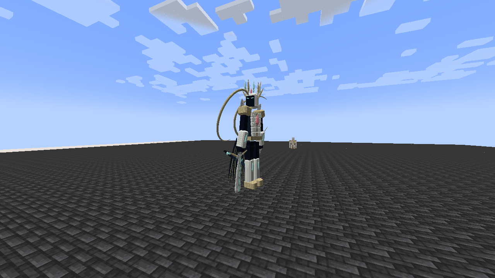

# Tensura Myths

> **Discontinued archive:** Tensura Myths ended at 0.36.1. No further updates are planned.

[All wikis](../README.md) · [Tensura Myths](Tensura-Myths.md)

Progression, skill combinations and Myth bosses for **Tensura: Reincarnated**. Final archived release: **0.36.1** · Minecraft **1.21.1** · NeoForge.

| Explore | Pages |
| --- | --- |
| Start | [Install](Getting-Started.md) · [In-game guide](In-Game-Guide.md) |
| Skills | [Unique](Unique-Skills.md) · [Ultimate](Ultimate-Skills.md) · [Godly](Godly.md) · [All abilities](Abilities.md) |
| Battlewills | [Schema](Schema.md) · [Air Walk](Air-Walk.md) · [Instant Transmission](Instant-Transmission.md) |
| Races | [Hunters](Evolution.md) · [Heavenly Restriction](Fettered-Human.md) · [Secondary races](Duo-Races.md) · [Awakening](Convergent-Awakening.md) |
| Encounters | [Ananke](Ananke.md) · [Eschaton](Eschaton.md) · [Alma and Gemma](Otherworlders.md) |
| Gear | [Inverted Spear of Heaven](Inverted-Spear-of-Heaven.md) · [Nullification](Nullification.md) |

[Download Myths 0.36.1](../../releases/tensura-myths-0.36.1.jar). Install this addon or TensuraAdditionalAdditions; do not install both in the same instance.

