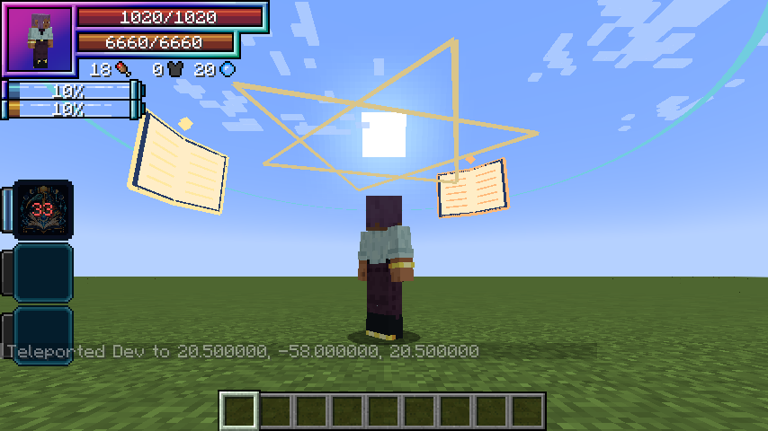
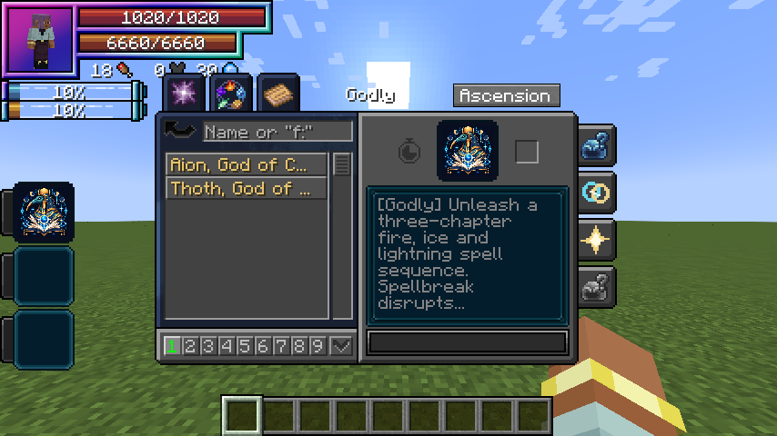

# Thoth, God of Magic

[Main Page](../README.md) · [Skills](Skills.md) · [Ability index](Abilities.md) · [Damage types](Damage-Types.md)

**Thoth, God of Magic** is a Godly Skill focused on **elemental sequences, disruption, conversion and autonomous spell fire**.

| Skill data | Thoth, God of Magic |
| --- | --- |
| **Information** | |
| Type | Godly Skill / native Ultimate |
| Combat role | Elemental sequences, disruption, conversion and autonomous spell fire |
| Active modes | 4 |
| Resource | Magicules |
| Toggleable passive | Arcane Sovereignty |
| Passive upkeep | 180 magicules / second |
| Registry ID | `wildhunt:thoth` |
| **Obtaining** | |
| Method | Mastered combination Ultimate + mastered Rune Smith; true awakening; 12M base EP |
| **Evolution** | |
| Evolution | — |

## Usage

### Passive

[Passive - Toggle] — **Arcane Sovereignty**

| Ability information | Value |
| --- | --- |
| Damage type | None — support / defense |
| Damage ID | — |
| Upkeep | 180 magicules / second |

Gain 75% Earth, Flame, Water/Ice, Wind, Light, Lightning and Space boost; 50% increased native Chant Speed; 25% reduced native Magic Cost Multiplier; 70 Magic Barrier; and a 1,000-capacity native Multilayer Barrier. Native spell-cost efficiency applies where Tensura reads that attribute; the art costs on this page remain fixed. Broken multilayer capacity recovers after ten seconds without a hit, at the next paid upkeep.

Enable the native skill toggle in Ability Selection. The first second is paid on enabling; upkeep is paid every twenty game ticks. It turns off when unfunded or blocked by native activation rules. Turning it off removes only its own modifiers. It is separate from active mode cycling.

### Active

| Mode | Magicules | Cooldown | Raw damage |
| --- | ---: | ---: | --- |
| 1. Lexicon of Ruin | 5,000 | 12 s | 500 fire / 400 ice / 600 lightning |
| 2. Spellbreak | 4,000 | 15 s | 180 |
| 3. Mana Crucible | 1,000 | 20 s | — |
| 4. Astral Library | 9,000 | 35 s | 240 per bolt |

Damage listed here is before native combat handling and uses **1 + 0.5 × mastery fraction**, capped at **1.5×**. These new kits do not use the apex skills’ 0.90 multiplier or the former 3× Ultimate multiplier. EP never multiplies their damage. Native elemental boosts, authority, resistances, barriers and hit immunity apply.

#### Lexicon of Ruin

[Active - Press] — **Lexicon of Ruin**

| Ability information | Value |
| --- | --- |
| Damage type | Fire elemental, then Ice elemental, then Lightning elemental |
| Damage ID | `tensura:fire_elemental`; `tensura:ice_elemental`; `tensura:lightning_elemental` |
| Resource cost | 5,000 magicules |
| Cooldown | 12 seconds |
| Raw damage | 500 fire / 400 ice / 600 lightning |

Mark a six-block-radius spell diagram within 64 blocks. Three chapters strike the fixed location at 0.6, 1.6 and 2.6 seconds. Each chapter hits up to eight visible enemies using its own native elemental source and animated magic circle. The sequence can be dodged by leaving its area.

#### Spellbreak

[Active - Press] — **Spellbreak**

| Ability information | Value |
| --- | --- |
| Damage type | Generic magic |
| Damage ID | `tensura:magic` |
| Resource cost | 4,000 magicules |
| Cooldown | 15 seconds |
| Raw damage | 180 |

Place a twelve-block-radius disruption field within 36 blocks, affecting up to six visible enemies. Each takes generic magic damage. Non-Godly owners additionally face native Silence and Magic Interference II for three seconds, and lose up to 1,500 current magicules. Half the drained magicules returns to you, capped at 2,000 total and your current maximum. Godly owners take the attack damage but are exempt from the drain and disruption.

#### Mana Crucible

[Active - Press] — **Mana Crucible**

| Ability information | Value |
| --- | --- |
| Damage type | None |
| Damage ID | — |
| Resource cost | 1,000 magicules |
| Cooldown | 20 seconds |
| Raw damage | — |

After paying its 1,000-magicule cast cost, convert two current aura into one missing magicule, up to 20,000 magicules. The transfer is limited by current aura and missing magicule capacity. It never increases maximum resources or refunds the cast payment. Requires at least two aura and more than 1,000 missing magicules before casting.

#### Astral Library

[Active - Press] — **Astral Library**

| Ability information | Value |
| --- | --- |
| Damage type | Rotating Fire, Ice and Lightning elemental |
| Damage ID | `tensura:fire_elemental`; `tensura:ice_elemental`; `tensura:lightning_elemental` |
| Resource cost | 9,000 magicules |
| Cooldown | 35 seconds |
| Raw damage | 240 per bolt |

For ten seconds, three open grimoires orbit above you. Starting after half a second and then every 0.75 seconds, fire at up to three visible enemies within 28 blocks. The chapter cycles Fire → Ice → Lightning. The formation moves with you; only one library per owner. Forgetting the skill, dying or changing dimension cancels it.

## Obtaining

Open **Skills → Godly → Ascension**, select one mastered [combination Ultimate](Ultimate-Skills.md), choose **Thoth**, then Ascend. Also master [Rune Smith](Rune-Smith.md), become a True Hero or True Demon Lord and reach **12,000,000 base EP**. Both the selected Ultimate and Rune Smith are combined into Thoth. Other skills remain learned. Presets and the longest remaining cooldown carry over. Owning Aion does not prevent earning Thoth using another valid source Ultimate.

## Suggested combo

Cast Astral Library before sustained combat → trap an approach in Lexicon of Ruin → Spellbreak a caster formation → convert spare aura with Mana Crucible when magicules are low.

## Strengths and limitations

Thoth has native Ultimate classification plus the Godly tag. It does not copy other skills or erase their ownership. Silence and interference still pass through Tensura’s native status rules. Conversion is a resource trade, not free regeneration.

Attacks respect teams, owned pets, creative/spectator immunity and server PvP settings. Native status resistances apply. World effects are bounded, expire automatically and do not damage terrain. Anchored effects do not persist across death, relog or dimension changes.

## Related pages

[Skills](Skills.md) · [Skill synthesis](Skill-Synthesis.md) · [Damage types](Damage-Types.md) · [Mechanics](Mechanics.md)

## Gallery

---

**Categories:** Tensura Myths · Skills
