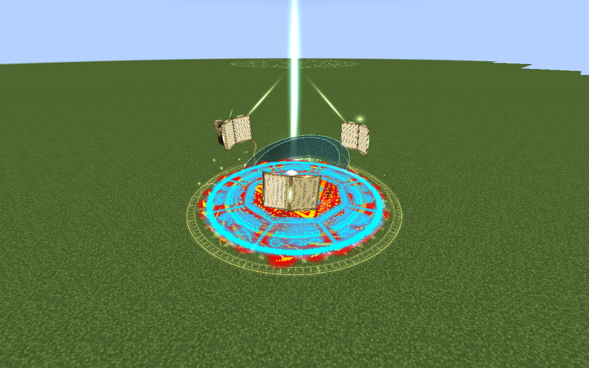
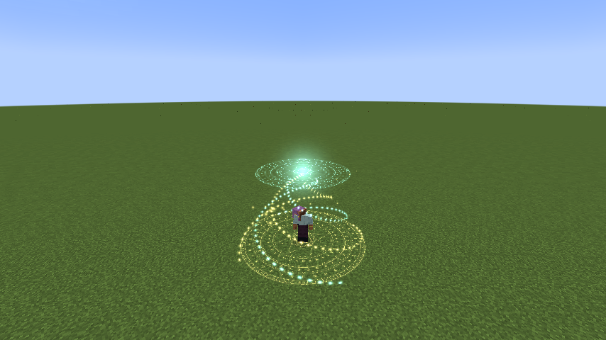

# Thoth, God of Magic

> **Discontinued archive:** Tensura Myths ended at 0.36.1. No further updates are planned.

[All wikis](../README.md) · [Tensura Myths](Tensura-Myths.md)

Thoth, God of Magic is a Godly Skill focused on elemental sequences, disruption, conversion and autonomous spell fire.

| Skill data | Value |
| --- | --- |
| Tier | Godly |
| Resource | Magicules; Mana Crucible converts aura |
| Passive upkeep | 180 magicules / second |
| Obtaining | Mastered combination Ultimate + mastered Rune Smith; true awakening; 12M total EP |

## Active abilities

| Ability | Damage type / base damage | Cost | Cooldown |
| --- | --- | --- | --- |
| Lexicon of Ruin | Fire, Water, Lightning, Earth, Wind, Light and Space elemental · 1,100 per chapter | 12,000 magicules | 12 s |
| Spellbreak | Generic magic · 900 | 6,500 magicules | 15 s |
| Mana Crucible | None | 2 aura per 1 magicule restored; no activation cost | None |
| Astral Library | Rotating Fire, Water, Lightning, Earth, Wind, Light and Space elemental · 800 per bolt | 24,000 magicules | 35 s |

## Classification passives

Owning this skill grants the always-active [Godly classification passives](Godly.md#classification-passives), independently of its toggle.

## Passive

- Damage type: None — support / defense
- Upkeep: 180 magicules / second
- Gain 75% Earth, Flame, Water/Ice, Wind, Light, Lightning and Space boost; 75% increased native Chant Speed; and 25% reduced native Magic Cost Multiplier. Thoth’s Godly boosts apply in addition to the strongest ordinary elemental source.

Element-cycling arts use **Earth, Fire, Water, Wind, Light, Lightning and Space**. Water covers the Water/Ice family; Ice is not a separate cycle step.

## Lexicon of Ruin

- Damage type: Fire, Water, Lightning, Earth, Wind, Light and Space elemental
- Resource cost: 12,000 magicules
- Cooldown: 12 seconds
- Raw damage: 1,100 per chapter
- Mark a six-block-radius spell diagram within 64 blocks. Seven chapters strike the fixed location at 0.60, 0.90, 1.25, 1.60, 1.90, 2.25 and 2.60 seconds, cycling Fire → Water → Lightning → Earth → Wind → Light → Space.

## Spellbreak

- Damage type: Generic magic
- Resource cost: 6,500 magicules
- Cooldown: 15 seconds
- Raw damage: 900
- Place a twelve-block-radius disruption field within 36 blocks, affecting up to six visible enemies. Each takes generic magic damage.

## Mana Crucible

- Damage type: None
- Resource cost: 2 aura per 1 magicule restored; no activation cost
- Cooldown: None
- Conversion speed: 5% of maximum magicules per second
- Duration / total conversion limit: None; hold to continue
- Hold the assigned skill key to continuously convert 2 current aura into 1 magicule. Restore 5% of maximum magicules per second.

Hold to continue, without an activation payment, cooldown, duration limit or total conversion cap. Only aura actually converted is spent.

## Astral Library

- Damage type: Rotating Fire, Water, Lightning, Earth, Wind, Light and Space elemental
- Resource cost: 24,000 magicules
- Cooldown: 35 seconds
- Raw damage: 800 per bolt
- For ten seconds, three open grimoires orbit above you. Starting after half a second and then every 0.25 seconds, fire at up to three visible enemies within 28 blocks.

## Related

[Skill synthesis](Skill-Synthesis.md) · [Godly Skills](Godly.md)

## Pictures and video

[Watch astral library](../media/astral-library.mp4)
