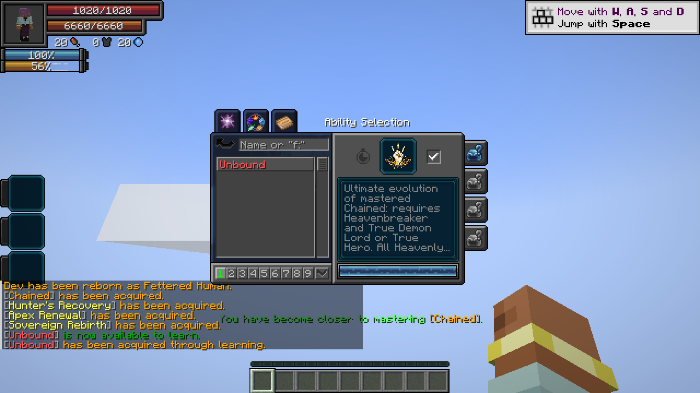

# Unbound

[Main Page](../README.md) · [Ultimate Skills](Ultimate-Skills.md) · [Chained](Chained.md) · [Heavenbreaker](Heavenbreaker.md)

**Unbound** is the Ultimate evolution of [Chained](Chained.md). The Heavenly Restriction remains binding, while its completed martial body gains stronger combat bonuses, automatic critical attacks and a defensive counter slash.

| Skill data | Unbound |
| --- | --- |
| **Information** | |
| Skill tier | Ultimate |
| Acquisition | Heavenbreaker + fully mastered Chained + True Demon Lord or True Hero |
| Native menu | Skills → Ultimate; equip and activate the evolution entry |
| Maximum mastery | 1,000; completed Chained mastery carries over |
| Active modes | Severance Rush; Counter |
| Resource | Aura |
| Damage type | Physical |
| Damage ID | `minecraft:mob_attack` |
| Toggle upkeep | None |

## Obtaining

Reach **Heavenbreaker**, fully master your permanent **Chained**, and become a **True Demon Lord or True Hero**. An unfinished Unbound entry appears in Tensura’s normal Ultimate skill list. Equip and activate the entry to evolve. All requirements are rechecked at completion; there is no additional EP threshold or EP payment.

Unbound replaces Chained and retains its completed mastery, toggle state, recorded inheritance, saved aura exemption, magicule ceiling and remaining Severance Rush cooldown. Chained slots across all nine presets become Unbound’s Severance Rush slots. The native Ultimate classification supplies normal Ultimate compatibility; this is not a Godly skill.

## Usage

### Heavenly Restriction

[Passive - True] — **Heavenly Restriction**

| Ability information | Value |
| --- | --- |
| Damage type | None |
| Damage ID | None |
| Activation | Learned ownership, independent of slots and toggle |

Retains [Chained’s pact](Chained.md#heavenly-restriction): **5× later aura-capacity gains**, unchanged starting aura, no new magicule capacity, up to **1 magicule/second** with remaining biome/rate/sleep output converted to aura, restricted final skill learning, and aura-paid resistance/nullification acquisition. The lineage keeps its **90% aura / 10% magicule** EP allocation; the blocked magicule share is not redirected. Existing usable skills and recorded reincarnation-derived grants remain available.

Unfinished skills can remain in the native menu and train; forbidden final acquisition leaves the entry unfinished and displays **“Cannot acquire [skill].”** with the skill name in its native tier color.

### Martial Supremacy

[Passive - Toggle] — **Martial Supremacy**

| Ability information | Value |
| --- | --- |
| Damage type | None directly; strengthens Physical and Battlewill attacks |
| Damage ID | None |
| Resource cost | None |

| Effect | Bonus |
| --- | --- |
| Battlewill learning / mastery points | +9 / +9 |
| Resistance/Nullification learning points | +19 |
| Damage sourced from Battlewill abilities | **8×**, takes priority over Physical |
| Other outgoing Physical damage | **5×** |
| Numeric Battlewill buff effectiveness | **4×**, excluding Aura Sword |

The damage branches are **mutually exclusive**. A Physical Battlewill receives 8×, not 8×5. Severance Rush and Counter are pure Physical skills and receive 5×. Aura Sword keeps its configured native damage increment and is excluded from buff amplification. Durations and resource costs retain native values. Tracked numeric buffs change to 4× without compounding; switching the toggle off restores the native buff values.

### Broken Limit

[Passive - True - Mastered] — **Broken Limit**

| Ability information | Value |
| --- | --- |
| Damage type | None directly; preserves each attack’s original type |
| Damage ID | None |
| Requirement | Learned, mastered Unbound; independent of slots and toggle |

Your attacks lower **Resistance → none** and **Nullification → Resistance**, bypass numeric resistance attributes, and ignore dodge. Attributable status effects use the corresponding lower-tier immunity rules. Learned defenses are not deleted, and native barriers retain their own rules.

**All attacks made by the player become critical hits**, including melee, owned projectiles, ability damage and direct spiritual attacks. Critical damage uses the native **critical damage multiplier** attribute (**1.5× by default**). Native melee criticals are counted once; projectiles and skills receive one corresponding critical multiplier. This remains active with Martial Supremacy off. A default mastered diamond-sword Aura Slash uses **14 × 8 × 1.5 = 168** before other modifiers and defenses, with the toggle enabled.

### Unerring Body

[Passive - In-slot] — **Unerring Body**

| Ability information | Value |
| --- | --- |
| Damage type | None |
| Damage ID | None |
| Requirement | Unbound equipped in the active preset |

Gain **30% incoming damage reduction**, **100% projectile dodge**, and **50% dodge against other damage**. Works with Martial Supremacy off. Reduction follows native Strengthen Body rules: invulnerability-bypassing damage and barrier bypass level **2 or greater** ignore it. Explicit dodge bypass still overrides dodge.

### Severance Rush

[Active - Press] — **Severance Rush**

| Ability information | Value |
| --- | --- |
| Damage type | Physical |
| Damage ID | `minecraft:mob_attack` |
| Resource cost | **2% current aura** |
| Cooldown | **1 second** |
| Movement | Instant teleport; **16-block aim reach** |
| Path / arrival radius | **3 / 4 blocks** |
| Base path damage | **1.5 × √A** |
| Base arrival damage | **3 × √A** |

**A** is aura actually spent. Targeting, ground/midair/water activation, enemy stopping, terrain clearance and independent path/arrival hits follow [Chained’s Severance Rush](Chained.md#severance-rush). With Martial Supremacy enabled and the default critical multiplier, player damage is base × **5 × 1.5**. The dash has no Battlewill classification or EP scaling.

### Counter

[Active - Press] — **Counter**

| Ability information | Value |
| --- | --- |
| Damage type | Physical |
| Damage ID | `minecraft:mob_attack` |
| Entry cost | **10% current aura**, paid once |
| Cooldown | **10 seconds**, starts on entry |
| Stance duration | **3 seconds** |
| Movement speed during stance | **0** |
| Slash range | Up to **64 blocks**, aimed toward the attacker |
| Slash hit radius | **3 blocks** |
| Base damage | **10 × D + 6 × √A** |
| Early cancellation | Press again; free, including during cooldown |

**D** is the first eligible enemy hit’s incoming damage before defenses; **A** is aura paid when entering the stance. That hit, including a direct spiritual attack, is completely negated before dodge, HP or SHP damage, the stance ends, and a massive instantaneous slash cuts toward the attacker through blocks. The slash extends at least 16 blocks and up to 4 blocks beyond the attacker, capped at 64 blocks. Enemies in its corridor receive one hit each; ordinary hurt cooldown does not erase that hit. Terrain stays intact.

For a **20-damage** incoming hit with **10,000 current aura** on entry, A = 1,000 and base slash damage is approximately **389.74**. With Martial Supremacy enabled and a default 1.5× critical multiplier, this becomes about **2,923.02**, before defenses and other modifiers. The base includes at least **10× the negated hit** plus aura scaling; it has no extra EP multiplier.

Environmental, self, allied and operator/void damage do not trigger Counter. Press again to cancel early, or let the three seconds expire; neither releases a slash or refunds entry cost. The cooldown remains. Death, logout, dimension changes, forgetting Unbound and native suppression end the stance and restore movement. The stance and its free cancellation state synchronize to the client.

Pale gold pressure lines mark the stance. The counter slash uses a broad layered crescent, dark cutting edge, white core, long pressure wake and expanding impact flash.

---

**Categories:** Tensura Myths · Skills · Ultimate
