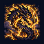
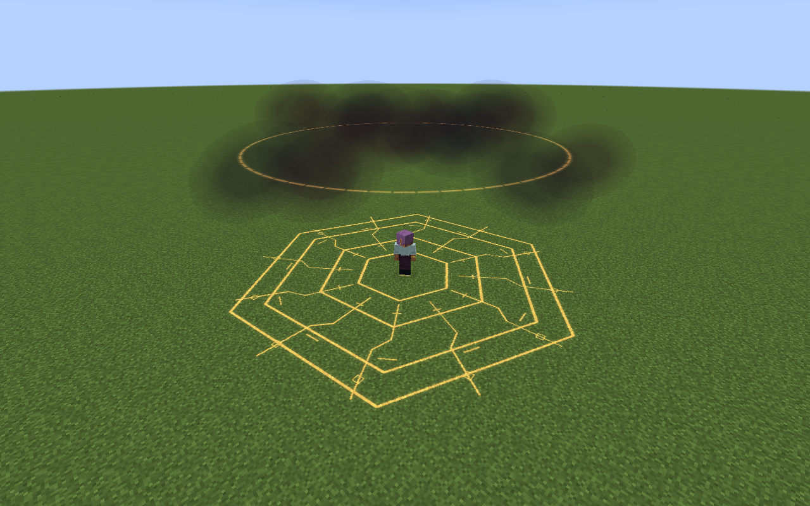

# Vritra, Lord of Cataclysm

[All wikis](../README.md) · [Tensura Myths](Tensura-Myths.md)

Vritra, Lord of Cataclysm is an Ultimate Skill focused on piercing plasma, delayed fire and travelling demolition.

| Skill data | Value |
| --- | --- |
| Tier | Ultimate |
| Resource | Aura |
| Passive upkeep | 120 aura / second |
| Obtaining | Synthesis: master both ingredients; 2M total EP |

## Active abilities

| Ability | Damage type / base damage | Cost | Cooldown |
| --- | --- | --- | --- |
| Plasma Bore | Lightning elemental + delayed Fire elemental · 1,500 lightning; 850 per fire fuse | 6,000 aura | 5 s |
| Thunderhead Crucible | Lightning elemental + delayed Fire elemental · 900 lightning + 500 fire per pulse | 15,000 aura | 16 s |
| Cataclysm Front | Fire elemental · 1,800 per eruption; 2,400 when empowered | 25,000 aura | 26 s |

## Passive

- Damage type: None — support / defense
- Upkeep: 120 aura / second
- Gain 100% Flame boost, 100% Lightning boost and 50% attack damage.

## Plasma Bore

- Damage type: Lightning elemental + delayed Fire elemental
- Resource cost: 6,000 aura
- Cooldown: 5 seconds
- Raw damage: 1,500 lightning; 850 per fire fuse
- Fire a solid-block-clipped plasma lance for 64 blocks, piercing up to eight visible enemies. While your thunderhead exists within 64 blocks, a second lance fires from its elevated center toward the same endpoint, clipped along its own route.

## Thunderhead Crucible

- Damage type: Lightning elemental + delayed Fire elemental
- Resource cost: 15,000 aura
- Cooldown: 16 seconds
- Raw damage: 900 lightning + 500 fire per pulse
- Place an eleven-block-radius storm furnace within 48 blocks for eight seconds. Once per second it strikes up to six visible enemies with lightning; each strike leaves a fire burst at that position after 0.6 seconds, in a three-block radius.

## Cataclysm Front

- Damage type: Fire elemental
- Resource cost: 25,000 aura
- Cooldown: 26 seconds
- Raw damage: 1,800 per eruption; 2,400 when empowered
- Send seven warned eruptions forward at four-block spacing, reaching 28 blocks. Each covers a 4.5-block radius.

## Related

[Skill synthesis](Skill-Synthesis.md) · [Godly Skills](Godly.md)

## Pictures and video

